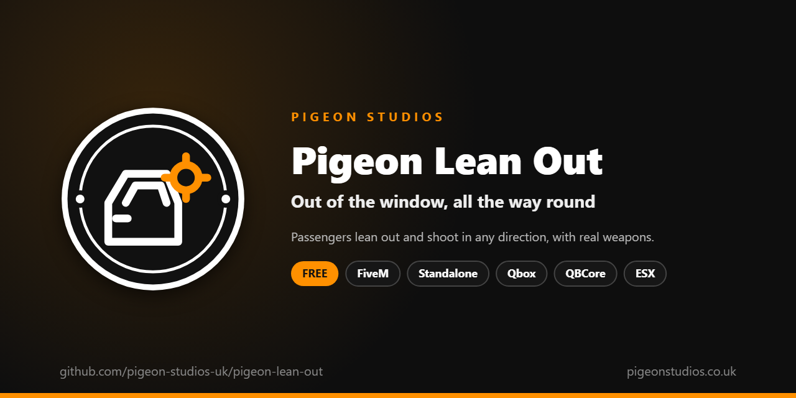

<div align="center">
  

  <h1>Pigeon Lean Out</h1>

  <p><strong>Lets passengers lean out of the window and shoot all the way round, with any weapon you allow.</strong></p>

  <p>
    <a href="https://github.com/pigeon-studios-uk/pigeon-lean-out/releases/latest"></a>
    <a href="LICENSE.md"></a>
    <a href="https://discord.gg/2NFVWEUmDF"></a>
    
  </p>

  <p>
    <a href="https://github.com/pigeon-studios-uk/pigeon-lean-out/releases/latest"><strong>Download</strong></a> ·
    <a href="#installation">Install</a> ·
    <a href="#configuration">Configure</a> ·
    <a href="CHANGELOG.md">Changelog</a> ·
    <a href="https://discord.gg/2NFVWEUmDF">Support</a>
  </p>
</div>

---

## Contents

- [Overview](#overview)
- [Features](#features)
- [How players use it](#how-players-use-it)
- [Requirements](#requirements)
- [Installation](#installation)
- [Updating](#updating)
- [Configuration](#configuration)
- [Fitting it to your vehicles](#fitting-it-to-your-vehicles)
- [Who can lean out](#who-can-lean-out)
- [Exports](#exports)
- [Localisation](#localisation)
- [How it works](#how-it-works)
- [Update checker](#update-checker)
- [Performance](#performance)
- [Security](#security)
- [Troubleshooting](#troubleshooting)
- [FAQ](#faq)
- [Support](#support)
- [Contributing](#contributing)
- [Licence](#licence)
- [Credits](#credits)

## Overview

Pigeon Lean Out is a free resource by [Pigeon Studios](https://pigeonstudios.co.uk) that lets passengers lean out of a vehicle's window to shoot. GTA's own drive-bys only allow pistols and SMGs, from a seat, in a narrow arc. Leaning out, a passenger can use a rifle or a shotgun, and turn to cover everything around the vehicle, over the roof and behind them.

It's one key to lean out and the same key to come back in. Every player sees it through the game's own sync. You choose which seats and vehicles can lean out, which weapons can be used, and who's allowed: everyone, or only certain jobs or staff.

## Features

- **One key.** G by default, which players can change in GTA's key bindings, or `/leanout`.
- **All the way round.** The character turns with the camera, so passengers can aim in any direction. Limit it to an arc, such as everything on their side, if you prefer.
- **Real weapons.** Rifles and shotguns work, not just drive-by weapons. Choose which are allowed; heavy weapons are blocked out of the box.
- **Everyone sees it.** It uses the game's own attachments and aiming, which every player's game already shows.
- **Back in their seat.** Coming back in puts the player in their own seat, or another free one if theirs was taken.
- **Safe.** They're brought back in automatically if they die or the vehicle is destroyed, and optionally above a speed you set.
- **Your rules.** Choose seats (front, rear), vehicle classes and single vehicles, a top speed for leaning out, and who can lean out by ACE permission or job.
- **Fits any vehicle.** The position comes from each vehicle's size, with settings by class and by vehicle, and an in-game tuner for staff to get it right.
- **Optional extras.** First person while leaning out, and the window rolled down.
- **23 languages.** Every message is in `locales/`, and it follows ox_lib's language setting.
- **Standalone.** No framework needed; job permissions use one if it's there.

## How players use it

1. Get in as a passenger.
2. Press **G** (or type `/leanout`). The window rolls down and the character leans out, facing out of their side of the vehicle.
3. Aim and shoot as on foot. Move the camera to turn. Reloading and the weapon wheel work as normal; moving, jumping, cover and melee are off while leaning out.
4. Press **G** again to come back in.

To change the key: **Settings → Key Bindings → FiveM → Lean out of the window / come back in**.

If they can't lean out, a short message says why, such as "You can't lean out while you're driving." or "You can't lean out of this vehicle."

## Requirements

| Requirement | Version | Notes |
|---|---|---|
| FXServer | A [recommended artifact](https://runtime.fivem.net/artifacts/) | |
| [ox_lib](https://github.com/communityox/ox_lib) | Optional | Used for messages if it's running |
| [Qbox](https://github.com/Qbox-project/qbx_core), [QBCore](https://github.com/qbcore-framework/qb-core) or [ESX Legacy](https://github.com/esx-framework/esx_core) | Optional | Only for job permissions |

**Frameworks:** none needed. It works the same on standalone servers, ESX Legacy, QBCore, Qbox and ox_core. Job permissions need Qbox, QBCore or ESX; ACE permissions work everywhere.

## Installation

1. **Download** `pigeon-lean-out.zip` from the [latest release](https://github.com/pigeon-studios-uk/pigeon-lean-out/releases/latest). Don't use the green **Code** button; release zips are the tested builds.
2. **Extract** it into your server's `resources` folder. The folder must be called `pigeon-lean-out`.
3. **Start it** by adding this to `server.cfg`, after your framework and ox_lib if you use them:

   ```cfg
   ensure pigeon-lean-out
   ```

4. **Let staff use the tuner** (optional, see [Fitting it to your vehicles](#fitting-it-to-your-vehicles)):

   ```cfg
   add_ace group.admin command.leanouttune allow
   ```

5. **Set your rules** in `configuration/config.lua` (see [Configuration](#configuration)). Out of the box, everyone can lean out from any passenger seat of cars, vans, trucks and the like, with any weapon except heavy weapons.
6. **Restart** your server. The console shows one line from the update checker:

   ```text
   [Pigeon Studios] Pigeon Lean Out v1.0.0 is up to date.
   ```

## Updating

1. Read the [changelog](CHANGELOG.md) for every version between yours and the latest, especially any **Upgrade notes**.
2. Back up your `configuration/` and `locales/` folders.
3. Replace the `pigeon-lean-out` folder with the new release.
4. Copy your settings, especially `Config.Offsets`, into the new `configuration/config.lua`. Don't copy the old file over the new one; new versions can add settings.
5. Restart the resource.

## Configuration

All settings are in `configuration/config.lua`, each with a comment explaining it.

| Setting | Default | What it does |
|---|---|---|
| `Config.Locale` | `'auto'` | Language: `'auto'` follows ox_lib's language, or a code from `locales/` such as `'de'` |
| `Config.Key` | `'G'` | The default key. Players can change it in GTA's key bindings |
| `Config.Command` | `'leanout'` | The command, which the key runs |
| `Config.Seats` | front and rear | Which passenger seats can lean out. The driver never can |
| `Config.MaxSpeed` | `0` | Fastest the vehicle can be going to lean out. `0` for no limit |
| `Config.PullInAboveSpeed` | `0` | Bring players back in above this speed. `0` never does |
| `Config.SpeedUnit` | `'mph'` | `'mph'` or `'kmh'`, for both speeds |
| `Config.RollDownWindow` | `true` | Roll down the window when a player leans out |
| `Config.AimArc` | `360` | Degrees players can turn, centred on straight out of their window |
| `Config.Weapons` | block `GROUP_HEAVY` | `mode` `'all'`, `'allow'` (only `list`) or `'block'` (all but `list`), with weapon names and groups |
| `Config.FirstPerson` | `false` | First person while leaning out |
| `Config.Vehicles.blockClasses` | 8, 13, 14, 15, 16, 21 | Vehicle classes nobody can lean out of: motorcycles, cycles, boats, helicopters, planes, trains |
| `Config.Vehicles.blockModels` | `{}` | Vehicles nobody can lean out of, by spawn name |
| `Config.Vehicles.allowModels` | `{}` | Vehicles never blocked by `blockClasses` |
| `Config.Offsets` | see below | Where players sit on the window |
| `Config.Allowed` | everyone | Who can lean out (see [Who can lean out](#who-can-lean-out)) |
| `Config.AllowedRefreshSeconds` | `60` | How often permissions are checked again, as well as on job and duty changes |
| `Config.TuneCommand` | `'leanouttune'` | The staff tuner's command |
| `Config.ShowMessages` | `true` | Tell players why they can't lean out, or why they were brought in |
| `Config.Notifications` | `'auto'` | `'auto'` (ox_lib if it's running), `'ox_lib'` or `'gta'` |

**Weapon groups:** `GROUP_PISTOL`, `GROUP_SMG`, `GROUP_RIFLE`, `GROUP_SHOTGUN`, `GROUP_MG`, `GROUP_SNIPER`, `GROUP_HEAVY`, `GROUP_THROWN` and `GROUP_MELEE`. Add-on weapons work by their own name and group.

**Vehicle classes:** 0 compacts · 1 sedans · 2 SUVs · 3 coupes · 4 muscle · 5 sports classics · 6 sports · 7 super · 8 motorcycles · 9 off-road · 10 industrial · 11 utility · 12 vans · 13 cycles · 14 boats · 15 helicopters · 16 planes · 17 service · 18 emergency · 19 military · 20 commercial · 21 trains · 22 open wheel. [The full list](https://docs.fivem.net/natives/?_0x29439776AAA00A62).

**Helicopters** are blocked by default because GTA already lets passengers in the back of most helicopters lean out and shoot from their seats.

## Fitting it to your vehicles

Every vehicle's windows sit at a different height. The character's position is worked out from where they were sitting and the vehicle's width, then moved by three numbers, in metres:

| Number | What it moves |
|---|---|
| `outward` | Out from the side of the vehicle. Negative is inside the body, so the waist sits in the window |
| `forward` | Along the vehicle. Positive is towards the front |
| `height` | Up from the seat. More puts more of the character out of the window |

`Config.Offsets.default` covers most cars. `classes` (by class number) and `models` (by spawn name) fill in or override it. Out of the box, SUVs, off-road, vans, emergency and commercial vehicles sit a little higher.

```lua
Config.Offsets = {
    default = { outward = -0.2, forward = 0.0, height = 0.35 },
    classes = {
        [12] = { height = 0.5 },   -- vans
    },
    models = {
        ['sultan'] = { outward = -0.2, forward = 0.0, height = 0.3 },
    },
}
```

**The tuner** finds the numbers for you. With `command.leanouttune` granted (see [Installation](#installation)):

1. Get in the vehicle as a passenger and lean out.
2. Type `/leanouttune`. The help box shows the current numbers.
3. **Arrow up / down** moves forward and back, **arrow left / right** moves in and out, **Page Up / Page Down** moves up and down, 2 cm a press. **Backspace** resets.
4. **Enter** prints the line for `Config.Offsets.models` in the F8 console. Check the name is the vehicle's spawn name, add the line to your config and restart the resource.
5. `/leanouttune` again closes the tuner.

Only the player using the tuner sees the change until it's in the config.

## Who can lean out

Out of the box, everyone. To limit it, set `Config.Allowed.everyone = false` and choose who can:

**By ACE permission**, granted in `server.cfg`:

```cfg
add_ace group.police pigeon-lean-out.use allow
```

**By job**, with Qbox, QBCore or ESX: list the job names (the name, such as `police`, not the label) in `Config.Allowed.jobs`. With `onDutyOnly`, only while on duty. ESX versions without a duty system count everyone as on duty.

```lua
Config.Allowed = {
    everyone = false,
    ace = 'pigeon-lean-out.use',
    jobs = { 'police', 'sheriff' },
    onDutyOnly = true,
}
```

Permissions are worked out on the server when a player joins, when their character loads, whenever their job or duty changes, and every `Config.AllowedRefreshSeconds`. Seats, vehicles and speed are checked in the player's game when they press the key.

## Exports

Server exports, for other resources:

```lua
-- Let a player lean out (true), stop them (false), or go back to Config.Allowed (nil).
-- Lasts until they leave the server.
exports['pigeon-lean-out']:SetAllowed(source, true)

-- True if this player is allowed to lean out right now. Seats, vehicles and speed still apply.
local allowed = exports['pigeon-lean-out']:IsAllowed(source)
```

## Localisation

Pigeon Lean Out comes in 23 languages: `en` English, `cs` Czech, `da` Danish, `de` German, `es` Spanish, `et` Estonian, `fi` Finnish, `fr` French, `hr` Croatian, `hu` Hungarian, `id` Indonesian, `it` Italian, `nl` Dutch, `no` Norwegian, `pl` Polish, `pt` Portuguese, `pt-br` Brazilian Portuguese, `ro` Romanian, `sl` Slovenian, `sv` Swedish, `tr` Turkish, `zh-cn` Simplified Chinese and `zh-tw` Traditional Chinese. They're the languages ox_lib ships, so your server may already have one set.

With `Config.Locale = 'auto'` (the default), it uses ox_lib's language, so one line in `server.cfg` sets it for this and every other resource that follows ox_lib:

```cfg
setr ox:locale "de"
```

Use `setr`, not `set`, so players' games get it too. Without it, or for a language that isn't in `locales/`, the text is English. To choose a language for this resource only, set `Config.Locale` to its code, such as `'fr'` or `'pt-br'`.

Chinese text can show as blank in GTA's own text, such as its notifications and help messages, because GTA only loads its Chinese font when the game itself is set to Chinese. ox_lib's notifications show every language.

Every file was checked for missing text and placeholders, but not every translation has been read by a native speaker yet. If something reads wrong, please send a fix; see [Contributing](#contributing). To add a language, copy `locales/en.lua` to a new file named with the language's code (such as `ja.lua`), change `Locales.en` at the top to match (`Locales.ja`), and translate the text in quotes. Keep words in `{curly brackets}` and the `~INPUT_...~` codes as they are.

## How it works

When a passenger presses the key, the resource checks they're allowed, then:

1. works out where they're sitting, relative to the vehicle, and which side they're on;
2. rolls down the window beside them (`Config.RollDownWindow`);
3. takes them out of the seat and attaches their character to the vehicle at that window, using the offsets for that vehicle, with collision with the vehicle off and ragdoll off;
4. every frame, turns the character to face where the camera is pointing (within `Config.AimArc`), keeps moving, jumping, cover and melee off, and keeps shooting off with a weapon that isn't allowed.

Aiming and shooting are the game's own, as on foot, which is why any weapon works. Attachments and aiming are synced to other players by the game itself; the resource sends nothing of its own.

Coming back in, the character is detached and put back in their seat, or another free one. If every seat is taken, they stay out until one is free, rather than being dropped at speed. If they die, or the vehicle is destroyed or deleted, they're let go straight away. They're also put back if the resource stops.

The server only works out who's allowed, and passes it to each player's game in a state bag (`pigeonLeanOutAllowed`), and runs `/leanouttune` so its ACE permission is checked there.

## Update checker

When it starts, Pigeon Lean Out checks our public [version registry](https://github.com/pigeon-studios-uk/pigeon-versions) once and prints one line in the server console saying whether it's up to date. If there's an update, it shows what's new and where to get it. The check is a single request to GitHub and sends nothing about your server or players.

Control it for every Pigeon Studios resource at once in `server.cfg`:

```cfg
set pigeon_update_check "on"      # default: one short line
set pigeon_update_check "quiet"   # only print when there's an update or a problem
set pigeon_update_check "off"     # never check
```

## Performance

Nothing runs while a player isn't leaning out, apart from a check four times a second for whether they are. While leaning out, it runs every frame: a few quick look-ups, and the character is only re-attached when the camera has turned. On the server, permissions are checked once a minute and on job changes, which is a quick look-up per player.

## Security

- It only moves the player's own character, in their own game.
- Who's allowed is decided on the server, from ACE permissions and the framework's own job data. The tuner's command is checked on the server too. The `SetAllowed` export can only be called by resources on your server.
- The only network event is the server telling one player's game to open the tuner, after checking their permission. Players can't send the resource anything.
- The only network request is the update check at start-up, from the server to GitHub. It sends nothing about your server or players.
- Like every rule that runs in the player's game, a player with a modified game could get around it. It's a gameplay feature, not an anti-cheat; pair it with your anti-cheat if that matters on your server.

Found a problem? Please don't open a public issue. Use the **Report a vulnerability** button in this repository's **Security** tab, or follow our [Security Policy](https://github.com/pigeon-studios-uk/.github/blob/main/SECURITY.md).

## Troubleshooting

**The character is too high, too low, or inside the door.**
Use the tuner (see [Fitting it to your vehicles](#fitting-it-to-your-vehicles)) and add the line it prints to `Config.Offsets.models`. For a whole class of vehicles, put the numbers in `Config.Offsets.classes` instead.

**Nothing happens when I press G.**
Check you're a passenger, not the driver. Check the key in **Settings → Key Bindings → FiveM**; if you changed it, the new key is the one to press. Try `/leanout`; if that shows a message, it says why.

**"You can't lean out of vehicles."**
`Config.Allowed.everyone` is `false` and you don't have the ACE permission or one of the jobs. Job permissions need Qbox, QBCore or ESX, started before this resource.

**"Every seat is taken."**
Someone got into your seat while you were out, and every other seat is full. You'll stay out until one is free, so you're never dropped at speed.

**I can't use my rifle while leaning out.**
Check `Config.Weapons`. Out of the box only heavy weapons are blocked.

**I also run Pigeon Driveby Rules.**
They work together. Driveby Rules covers shooting from a seat; while a player is leaning out they aren't in a seat, so only this resource's rules apply.

**The console says "isn't in the version registry" or "couldn't check for updates".**
Your server couldn't reach GitHub, or the check is blocked by a firewall. The resource works normally either way. Turn the check off with `set pigeon_update_check "off"`.

## FAQ

**Is it really free?**
Yes. Use it on as many servers as you like, including ones that take donations. You just can't reupload, resell or bundle it. See [Licence](#licence).

**Can the driver lean out?**
No. Someone has to drive.

**Do other players see it?**
Yes. The game shows other players' attachments and aiming already.

**Does it work in helicopters?**
Helicopters are blocked by default, because GTA already lets passengers in the back of most helicopters lean out and shoot. Remove 15 from `Config.Vehicles.blockClasses` to allow them anyway.

**Does it affect NPCs?**
No. Only players can lean out.

## Support

Read [Troubleshooting](#troubleshooting) first, then ask in the support channels of our [Discord](https://discord.gg/2NFVWEUmDF). Please include your Pigeon Lean Out version, FXServer artifact, framework, the vehicle and any errors from the console (F8 in game). See [Getting help](https://github.com/pigeon-studios-uk/.github/blob/main/SUPPORT.md).

Found a bug? Open a [bug report](https://github.com/pigeon-studios-uk/pigeon-lean-out/issues/new/choose).

## Contributing

Fixes, improvements, offsets for more vehicles and translations are welcome. Please read the [contributing guide](https://github.com/pigeon-studios-uk/.github/blob/main/CONTRIBUTING.md) first, and open a feature request before working on anything big.

## Licence

Pigeon Lean Out is free to use under the **[Pigeon Studios Free Licence](LICENSE.md)**.

- ✅ Use it on any number of servers, including monetised ones
- ✅ Change it for your own servers
- ✅ Show it in videos and streams
- ❌ Don't reupload, share or mirror the files; link to this repository instead
- ❌ Don't sell it, bundle it in packs, or put it behind escrow
- ❌ Don't remove the credits

This summary isn't the licence; [LICENSE.md](LICENSE.md) is. Third-party components are listed in [NOTICE.md](NOTICE.md).

## Credits

Made by [Pigeon Studios](https://pigeonstudios.co.uk). Thanks to everyone who has contributed fixes and translations; see the [changelog](CHANGELOG.md).

<sub>Not affiliated with or endorsed by Rockstar Games, Take-Two Interactive or Cfx.re.</sub>
